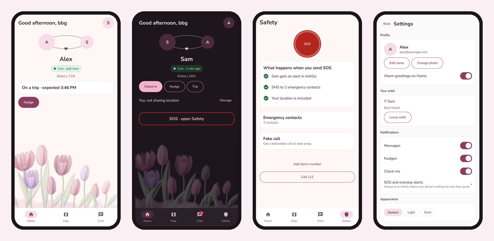
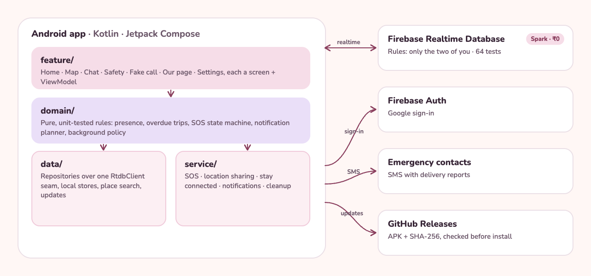

<p align="center">
  
</p>

<p align="center">
  
  
  
  
  
</p>

<p align="center">
  <b>AshGo</b> is a private Android app for two people: one who heads out, and one who keeps watch.<br>
  Live location while it matters, trips that raise their hand when you're late,<br>
  an SOS that's honest about what it actually sent, and a little shared corner of your own.
</p>

<p align="center">
  
</p>

---

## Why it exists

Commercial safety apps want an account, a subscription and your location history. AshGo wants none of that. It's one orbit of two people, a Firebase project you own, and a design rule that runs through every screen: **never claim more than you know.** If a phone hasn't reported in, AshGo says when it last did. If an SMS hasn't been confirmed delivered, it doesn't say "delivered".

## Two roles, one orbit

| | The one who **joins** the orbit | The one who **creates** it |
|---|---|---|
| **Role** | Heads out, and is looked after | Keeps watch |
| **Location** | Shares live, pauses (1 h, until morning, until resumed) or stops | Follows them on the map |
| **Trips** | Starts trips with a destination and an "expect me back by" time | Sees the trip, and gets an alert if it's overdue |
| **SOS** | Hold for 3 seconds: an in-app alert plus SMS to emergency contacts | Gets a full-screen alert, even on the lock screen, and acknowledges it |
| **Together** | Chat with photos, check-ins, loud nudges, a shared photo wall | The same |

The server enforces the roles too: only the person who joined can write location, trips or SOS.

## Features

<table>
<tr>
<td width="50%" valign="top">

**🛟 Safety**
- **SOS by deliberate hold**, from the app, the home-screen widget or Quick Settings. Nothing is ever sent by a single tap.
- **Honest receipts:** *Sent* → *Delivered* only when the network's report comes back, plus *Seen by* when the watcher acknowledges.
- **Trips with overdue alerts**, an *I'm safe* button (needs an unlock on the lock screen), and *+15 min*.
- **Fake call:** a believable incoming call with a voice you choose, to step away from a situation.

</td>
<td width="50%" valign="top">

**🗺️ Location**
- **Live sharing you control:** live, timed pauses, or off. Stopping removes the last point.
- **Place search** for trip destinations, using Android's built-in geocoder (free, no API key).
- **Saved places** like *Home* or *PG*: one tap, stored only on that phone.
- **Custom return time** with a ✎ time picker.

</td>
</tr>
<tr>
<td valign="top">

**💬 Together**
- **Chat** with photos (shrunk on the phone first), with *Sent*, *Delivered* and *Seen* receipts.
- **Loud nudge:** one distinct beep on the alarm stream that rings through silent mode, and through Do Not Disturb once allowed.
- **Check-ins** such as *home safe* or *on my way*.
- **Our page:** a shared photo wall, hung on ropes, that both phones see.

</td>
<td valign="top">

**🔧 Reliability, without a push server**
- **Notifications on the free plan:** a small connected service carries alerts during trips and followed sharing, and stops when there's nothing to watch.
- **A Reliability screen** that checks every setting that can silently block an alert, each with a one-tap fix.
- **In-app updates** from this repo's public releases, with every APK SHA-256-verified before Android's installer opens.

</td>
</tr>
</table>

## Privacy by design

- **Your data, your Firebase:** no AshGo server, no third parties, no ads, no analytics.
- **Only the two of you can read it**, enforced by Realtime Database rules with [64 emulator tests](firebase/test).
- **Short retention:** messages 7 days · photos 3 days · check-ins 7 days · trips 24 h after they end · cancelled SOS 30 days. Leaving the orbit deletes everything.
- **Stays on the phone:** emergency contacts, saved places and fake-call voices never leave the device, and are excluded from cloud backup.
- **No secrets in the APK:** updates need no token; the app checks a SHA-256 before anything installs.

## Architecture

<p align="center">
  
</p>

- **Pure domain logic** (presence, overdue phases, the SOS state machine, the notification planner, background policy) is unit-tested without Android.
- **One `RtdbClient` seam** with an in-memory fake, so repositories and view-models are tested against realistic database behaviour: offline writes, denied reads, server time.
- **Manual dependency injection** through a single `AppContainer`, with no DI framework.
- **Built for ₹0:** Spark plan only. No Cloud Functions, no Storage, no FCM server, no paid APIs.

## Tech stack

**Kotlin 2.4** · **Jetpack Compose** (Material 3) · **Coroutines and Flow** · **Firebase Realtime Database and Auth** · **Credential Manager** (Google sign-in) · **osmdroid** with OpenStreetMap tiles · **Fused Location Provider** · **WorkManager** · **DataStore** · **R8**

## Getting started

```bash
# Unit tests (JVM)
./gradlew :app:testDebugUnitTest

# UI tests on a running emulator or device
./gradlew :app:connectedDebugAndroidTest

# Database rules tests (starts the Firebase emulator itself)
cd firebase && npm install && npm test

# Release APK (R8, signed with the project's key)
./gradlew :app:assembleRelease
```

The app needs your own `app/google-services.json` from a Firebase project with Google sign-in enabled. Debug builds can point at the local Firebase emulators: open the app with `--ez useEmulators true`.

## Releasing an update

```bash
scripts/publish-release.sh "What changed, in one line"
```

The script runs the tests, builds the APK, publishes it to the public [AshGo-releases](https://github.com/varad-oss/AshGo-releases) repo, and writes the version, URL and SHA-256 to Firebase. Every installed copy then shows **Update available** the next time it opens. See [docs/v2/RELEASING.md](docs/v2/RELEASING.md).

## Project layout

```
app/src/main/java/com/varad/unstoppableash/
├── core/        results and time
├── domain/      pure rules: presence, trips, SOS, notifications, retention
├── data/        Firebase repositories, local stores, media, places, updates
├── service/     SOS, location sharing, staying connected, notifications, cleanup
├── feature/     home · map · chat · safety · fake call · our page · settings · onboarding
└── ui/          theme (the Orbit palette), components, navigation
firebase/        database rules (phase 1 and phase 2) and their emulator tests
design/          the watercolour tulip painting, re-exportable as app images
docs/v2/         spec, architecture, security audit, release and device checklists
```

## Documentation

| Document | What's inside |
|---|---|
| [Redesign spec](docs/v2/REDESIGN_SPEC.md) | Screens, states and copy |
| [Architecture](docs/v2/ARCHITECTURE_PROPOSAL.md) | Data model, rules, layering |
| [Security and privacy audit](docs/v2/SECURITY_PRIVACY_AUDIT.md) | What was fixed and how |
| [Product decisions](docs/v2/PRODUCT_DECISIONS.md) | The calls made, and why |
| [Device verification](docs/v2/DEVICE_VERIFICATION.md) | The real-phone checklist |
| [Releasing](docs/v2/RELEASING.md) | How updates are published |

---

<p align="center">
  <sub>Made with care by <a href="https://github.com/varad-oss">Varad</a>, for someone special. 🌷</sub>
</p>
