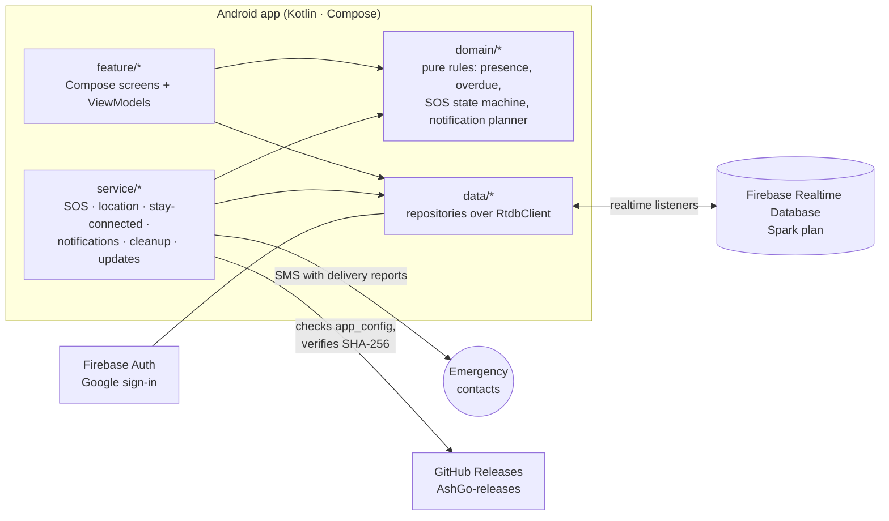

<p align="center">
  
</p>

<p align="center">
  <a href="https://github.com/varad-oss/AshGo/actions/workflows/ci.yml"></a>
  
  
  
  
  
</p>

<p align="center">
  <b>AshGo</b> is a private Android app for two people: one who heads out, and one who keeps watch.<br>
  Live location while it matters, trips that raise their hand when you're late,<br>
  an SOS that's honest about what it actually sent, and a little shared corner of your own.
</p>

<p align="center">
  <a href="#screens">Screens</a> ·
  <a href="#architecture">Architecture</a> ·
  <a href="#security-and-migration-status">Security status</a> ·
  <a href="docs/v2/SECURITY_PRIVACY_AUDIT.md">Security &amp; privacy audit</a> ·
  <a href="#tests">Tests</a> ·
  <a href="docs/v2/DEVICE_VERIFICATION.md">Device checklist</a>
</p>

<a id="screens"></a>
<p align="center">
  
</p>

---

## Why it exists

Commercial safety apps want an account, a subscription and your location history. AshGo wants none of that. It's one orbit of two people, a Firebase project you own, and a design rule that runs through every screen: **never claim more than you know.** If a phone hasn't reported in, AshGo says when it last did. If an SMS hasn't been confirmed delivered, it doesn't say "delivered".

## Two roles, one orbit

| | The one who **joins** the orbit | The one who **creates** it |
|---|---|---|
| **Role** | Heads out, and is looked after | Keeps watch |
| **Location** | Shares live, pauses (1 h, until morning, until resumed) or stops | Follows them on the map |
| **Trips** | Starts trips with a destination and an "expect me back by" time | Sees the trip, and gets an alert if it's overdue |
| **SOS** | Hold for 3 seconds: an alert to the watcher plus SMS to emergency contacts | Gets a full-screen alert, even on the lock screen, **when AshGo is open or connected** (see below), and acknowledges it |
| **Together** | Chat with photos, check-ins, loud nudges, a shared photo wall | The same |

The server enforces the roles too: only the person who joined can write location, trips or SOS.

## Features

<table>
<tr>
<td width="50%" valign="top">

**🛟 Safety**
- **SOS by deliberate hold**, from the app, the home-screen widget or Quick Settings. Nothing is ever sent by a single tap.
- **Honest receipts:** *Sent* → *Delivered* only when the network's report comes back, plus *Seen by* when the watcher acknowledges.
- **Trips with overdue alerts**, an *I'm safe* button (needs an unlock on the lock screen), and *+15 min*.
- **Fake call:** a believable incoming call with a voice you choose, to step away from a situation (rings while AshGo is open).

</td>
<td width="50%" valign="top">

**🗺️ Location**
- **Live sharing you control:** live, timed pauses, or off. Stopping removes the last point.
- **Place search** for trip destinations, using Android's built-in geocoder (free, no API key).
- **Saved places** like *Home* or *PG*: one tap, stored only on that phone.
- **Custom return time** with a ✎ time picker.

</td>
</tr>
<tr>
<td valign="top">

**💬 Together**
- **Chat** with photos (shrunk on the phone first), with *Sent*, *Delivered* and *Seen* receipts.
- **Loud nudge:** one distinct beep on the alarm stream that rings through silent mode, and through Do Not Disturb once allowed.
- **Check-ins** such as *home safe* or *on my way*.
- **Our page:** a shared photo wall, hung on ropes, that both phones see.

</td>
<td valign="top">

**🔧 Reliability, without a push server**
- **Notifications on the free plan:** with no push server, a small connected service carries alerts **only** during the traveller's trip, or while the watcher follows live sharing. The rest of the time a cleared AshGo is really stopped, so an SOS reaches the watcher by **SMS**, if they are one of the emergency contacts. Delivery is best-effort: aggressive battery managers can still stop the service.
- **A Reliability screen** that checks every setting that can silently block an alert, each with a one-tap fix.
- **In-app updates** from this repo's public releases, with every APK SHA-256-verified before Android's installer opens.

</td>
</tr>
</table>

## Privacy by design

- **Who can read the shared data:** only the two signed-in members of an orbit, enforced by the Realtime Database rules ([tests](firebase/test)). The Firebase project owner, through the console or Admin SDK, and Google, as the processor, can also access it. There is **no end-to-end encryption**, only TLS to Firebase.
- **No AshGo server, no ads, no analytics.** Third parties: Firebase (Google) for the database and sign-in, OpenStreetMap for map tiles, Android's geocoder for place search, GitHub for update downloads, and your carrier for SOS SMS.
- **Short retention:** messages 7 days · photos 3 days · check-ins 7 days · trips 24 h after they end · cancelled SOS 30 days. Leaving the orbit deletes everything shared. Pruning runs on the members' phones (the Spark plan has no Cloud Functions), so it happens when the app runs.
- **Stays on the phone:** emergency contacts, saved places and fake-call voices are never uploaded, and app data is excluded from cloud backup and device transfer. Logs carry no phone numbers or coordinates.
- **Nothing secret in the APK:** it holds only Firebase's public client identifiers, which are not credentials; access is decided by the rules. Updates need no token, and the app checks the SHA-256 and size before Android's installer opens.

## Security and migration status

The database rules come in two stages, and the difference matters:

| Stage | File | Legacy v1 paths (`chat`, `tracking`, `alerts`, `buzz`, `users`) | v2 data (`pairs/*`, `invites`, `userPairs`) |
|---|---|---|---|
| Phase 1 (transition) | [`database.rules.json`](firebase/database.rules.json) | **Readable and writable by any signed-in account**, so v1 phones keep working | Pair-isolated |
| Phase 2 (final) | [`database.rules.phase2.json`](firebase/database.rules.phase2.json) | **Closed** | Pair-isolated, with identical rules |

- **Moving to phase 2 requires:** both phones running v2, the legacy data deleted (v2 doesn't read it), then the owner deploying the phase-2 rules and checking that v1 paths are denied.
- **Recorded status:** the owner deployed phase 2 and deleted the legacy nodes during the v2 rollout (October 2026; see the [audit](docs/v2/SECURITY_PRIVACY_AUDIT.md)). **The repository cannot prove what is deployed right now.** Compare the console's Rules tab with the phase-2 file.
- **Deploy target:** `firebase.json` now deploys the phase-2 file, so a routine `firebase deploy` can't reopen the legacy paths. A test fails if that ever changes.
- **Release signing:** releases are signed with the owner's existing key, kept so installed copies update in place. See [Builds](#debug-and-release-builds).
- **Old personal media:** some still sits in git history (not in the current tree). The owner chose to accept this.

## Architecture



- **Pure domain logic** (presence, overdue phases, the SOS state machine, the notification planner, background policy) is unit-tested without Android.
- **One `RtdbClient` seam** with an in-memory fake, so repositories and view-models are tested against realistic database behaviour: offline writes, denied reads, server time.
- **Manual dependency injection** through a single `AppContainer`, with no DI framework.
- **Built for ₹0:** Spark plan only. No Cloud Functions, no Storage, no FCM server, no paid APIs.

## Tech stack

**Kotlin 2.4** · **Jetpack Compose** (Material 3) · **Coroutines and Flow** · **Firebase Realtime Database and Auth** · **Credential Manager** (Google sign-in) · **osmdroid** with OpenStreetMap tiles · **Fused Location Provider** · **WorkManager** · **DataStore** · **R8**

<a id="tests"></a>
## Getting started and tests

**Prerequisites:** JDK 17+ (21 in CI), the Android SDK (compileSdk 37), and Node 22 for the rules tests. The Firebase CLI comes in through `firebase/package.json`, so there is no global install.

**Your own Firebase project:**
1. Create a project on the Spark plan, then add a Realtime Database and an Android app with the package `com.varad.unstoppableash`.
2. Enable **Google** sign-in in Authentication, and add your debug key's SHA-1 to the Android app.
3. Download `google-services.json` into `app/`. It is git-ignored.
4. Deploy the phase-2 rules: `cd firebase && npx firebase deploy --only database --project <your-project>`.

```bash
# JVM unit tests and lint (no device needed)
./gradlew :app:testDebugUnitTest :app:lintDebug

# Database rules, both stages, against the local emulator (project "demo-ashgo", never a real one)
cd firebase && npm ci && npm test

# UI tests: these need a running emulator, and they wipe the app's data on whatever device they run on
./gradlew :app:connectedDebugAndroidTest
```

[CI](.github/workflows/ci.yml) runs the unit tests, lint and the rules suite on every push and pull request. It has read-only permissions and no secrets, and uses a placeholder Firebase config. It does **not** run device tests.

What automated tests can't show (real SMS delivery, background behaviour on real phones, lock-screen alerts, deployed rules) is in the manual two-phone [device checklist](docs/v2/DEVICE_VERIFICATION.md).

<a id="debug-and-release-builds"></a>
### Debug and release builds

| | Debug (`assembleDebug`) | Release (`assembleRelease`) |
|---|---|---|
| Debuggable | Yes | No, and R8 is on |
| Local Firebase emulators | Opt-in: launch with `--ez useEmulators true` | Never; the switch is ignored |
| Signed with | This machine's debug key | This machine's **debug key** (`signingConfig = debug`) |

The official APKs are built on the owner's machine with the same key that signed every earlier install, so Android accepts them as updates. A release you build from a fresh clone is signed with *your* debug key: it installs, but it can never update the published app, which is how signature checking should work. Moving to a dedicated release key would need APK key rotation and is an owner decision.

## Releasing an update

```bash
scripts/publish-release.sh "What changed, in one line"
```

This is owner-only: it needs the owner's signing key, GitHub and Firebase logins. The script runs the tests, builds the APK, publishes it to the public [AshGo-releases](https://github.com/varad-oss/AshGo-releases) repo, and writes the version, URL and SHA-256 to Firebase. Every installed copy then shows **Update available** the next time it opens. See [docs/v2/RELEASING.md](docs/v2/RELEASING.md).

## Project layout

```
app/src/main/java/com/varad/unstoppableash/
├── core/        results and time
├── domain/      pure rules: presence, trips, SOS, notifications, retention
├── data/        Firebase repositories, local stores, media, places, updates
├── service/     SOS, location sharing, staying connected, notifications, cleanup
├── feature/     home · map · chat · safety · fake call · our page · settings · onboarding
└── ui/          theme (the Orbit palette), components, navigation
firebase/        database rules (phase 1 and phase 2) and their emulator tests
.github/         CI: unit tests, lint, rules tests
design/          the watercolour tulip painting, re-exportable as app images
docs/v2/         spec, architecture, security audit, release and device checklists
```

## Documentation

| Document | What's inside |
|---|---|
| [Redesign spec](docs/v2/REDESIGN_SPEC.md) | Screens, states and copy |
| [Architecture](docs/v2/ARCHITECTURE_PROPOSAL.md) | Data model, rules, layering |
| [Security and privacy audit](docs/v2/SECURITY_PRIVACY_AUDIT.md) | What was fixed and how |
| [Product decisions](docs/v2/PRODUCT_DECISIONS.md) | The calls made, and why |
| [Device verification](docs/v2/DEVICE_VERIFICATION.md) | The real-phone checklist |
| [Releasing](docs/v2/RELEASING.md) | How updates are published |
| [v1 audit](docs/v2/CURRENT_STATE_AUDIT.md) · [feature matrix](docs/v2/FEATURE_MATRIX.md) | Historical snapshots of v1, dated 2026-10-13 |

---

<p align="center">
  <sub>Made with care by <a href="https://github.com/varad-oss">Varad</a>, for someone special. 🌷</sub>
</p>
